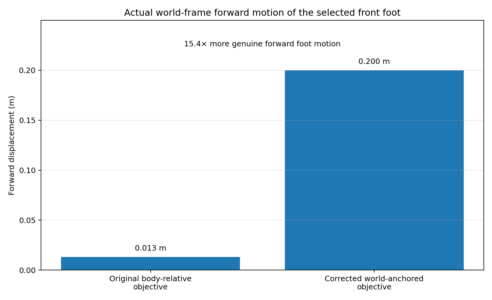
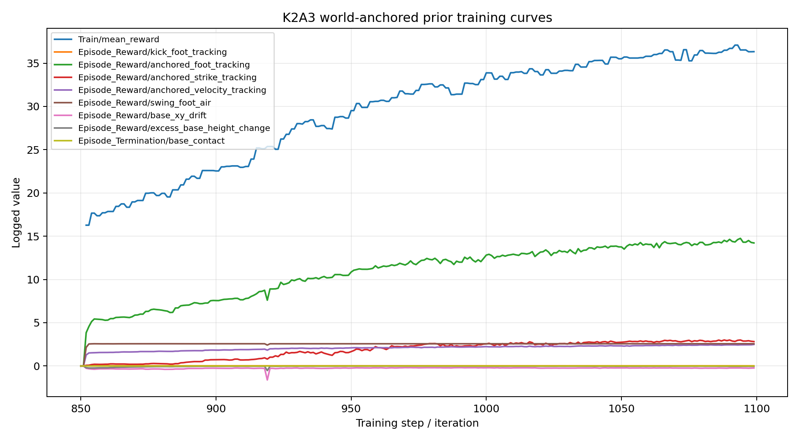
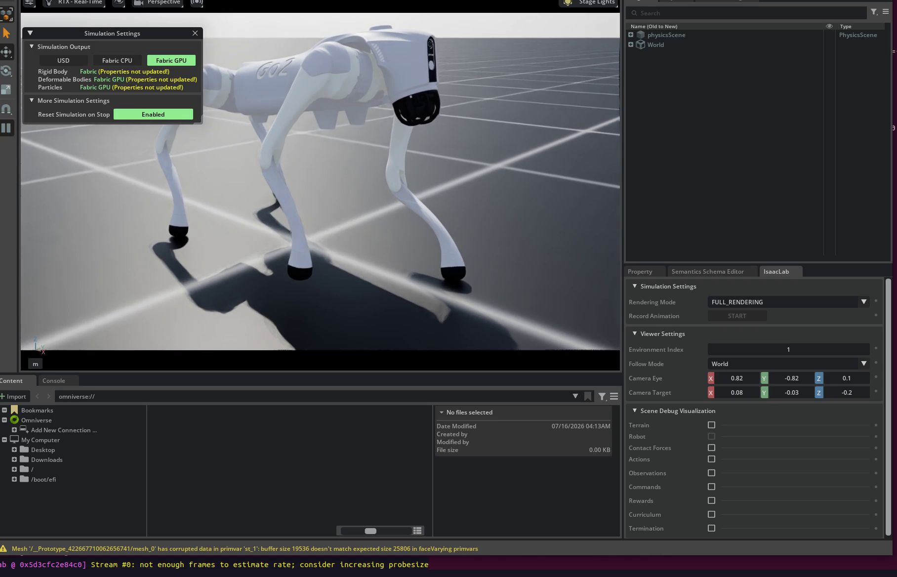
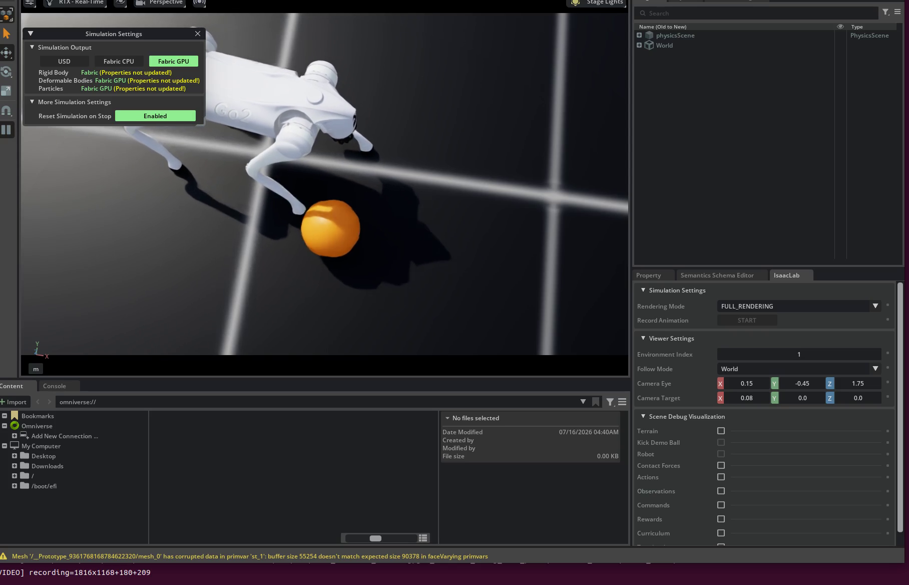

# Building Soccer Environment for Unitree Go2 in Isaac Lab

**Author:** Lishengqi Jiang 
**Date:** 07/13/2026  

---

## 1. Project Overview

The long-term objective of this project is to train a Unitree Go2 quadruped to complete a simplified autonomous 1v0 soccer task in Isaac Lab.

The intended behavior includes:

1. observing the ball, field, and goal state;
2. locating the ball from different relative positions;
3. approaching the ball using pretrained locomotion;
4. repositioning around the ball;
5. aligning the robot, ball, and goal direction;
6. selecting an appropriate kick action;
7. transferring momentum to the ball through physical contact;
8. scoring without directly modifying the ball velocity.

The project is based on an existing Franklin-style soccer environment. The Franklin implementation already defines the high-level task interface:

- an 86-dimensional observation;
- a 13-action discrete action space;
- soccer event and reward logic;
- team and goal representations;
- game-time and episode-step accounting.

The current work focuses on transferring this high-level interface into an Isaac Lab environment with a physically simulated Unitree Go2.

The resulting system uses hierarchical control:

```text
Franklin-style high-level soccer policy
                |
                v
        13 discrete actions
                |
      +---------+----------+
      |                    |
      v                    v
Pretrained Go2        Learned physical
locomotion policy     kick policy
      |                    |
      +---------+----------+
                |
                v
        12 Go2 joint targets
                |
                v
       Isaac Lab / PhysX
                |
                v
     Physical robot and ball state
                |
                v
Franklin-compatible observation and reward
```

---

## 2. Transition from the Franklin Environment to Isaac Lab

The Franklin code represents soccer through a high-level game-state and action interface. The Isaac Lab version must preserve this interface while introducing three-dimensional robot dynamics, joint control, contact, balance, and physical execution delays.

### 2.1 Franklin components retained

The following high-level concepts are retained:

- observation dimension and feature ordering;
- discrete action semantics;
- goal and team representation;
- time-left representation;
- high-level episode length;
- goal-event reward;
- policy-facing environment interface.

The intended high-level action space remains:

| Action | Meaning |
|---:|---|
| 0 | Stop |
| 1 | Move forward |
| 2 | Move backward |
| 3 | Turn left |
| 4 | Turn right |
| 5–12 | Kick with different requested strengths |

The final soccer reward remains:

| Event | Reward |
|---|---:|
| Team A scores | +1 |
| Team B scores | -1 |
| Other state transitions | 0 |

### 2.2 Components introduced by the 3D physical environment

The Isaac Lab backend adds:

- a Unitree Go2 articulation;
- 12 actuated joints;
- pretrained low-level locomotion;
- full three-dimensional root pose and velocity;
- roll, pitch, and yaw dynamics;
- rigid-body contact;
- support-leg stability;
- a physical soccer ball;
- collision-based goal and field events;
- low-level policy state and reset logic.

The same high-level command does not always produce the same state transition. Physical execution depends on:

- controller response time;
- acceleration and deceleration;
- turning radius;
- contact and friction;
- temporary imbalance;
- joint and actuator limits;
- asymmetric left and right behavior.

The environment therefore returns the physical state measured after execution rather than deriving the next state from the requested command.

### 2.3 Orientation as a central migration issue

The transition from a 2D game abstraction to a 3D quadruped environment introduces a more complex orientation problem.

In the high-level soccer task, yaw determines whether the robot is facing the ball or goal. In the physical environment, roll and pitch also affect:

- locomotion stability;
- the validity of a kick;
- the position of the kicking foot;
- contact geometry;
- whether a high-level action can be completed safely.

The orientation representation must remain compatible with the Franklin observation while preserving enough physical information to distinguish:

- correct heading with stable posture;
- correct heading while leaning or falling;
- temporary turning motion;
- stable kick-ready posture.

---

## 3. Environment Architecture

The environment is separated into several layers.

### 3.1 High-level Franklin-compatible environment

The high-level environment exposes:

```text
Observation: 86-dimensional vector
Action: one integer from 0 to 12
Reward: soccer event reward
Termination: episode or physical task condition
```

The high-level policy does not output joint targets. It selects a locomotion or kick skill.

### 3.2 Action execution layer

The action execution layer maps the 13 actions to low-level control.

```text
Actions 0–4
    -> pretrained Go2 locomotion policy

Actions 5–12
    -> learned physical kick policy
```

Locomotion actions are converted into body-frame velocity commands:

```text
[forward velocity, lateral velocity, yaw rate]
```

The pretrained locomotion policy converts these commands and the current robot state into 12 joint targets.

The planned kick interface is:

```text
kick policy(
    robot state,
    ball-relative state,
    requested kick strength,
    motion phase
)
-> 12 joint-position targets
```

### 3.3 Isaac Lab physical backend

The physical backend handles:

- simulation stepping;
- joint-target application;
- articulation state updates;
- ball rigid-body updates;
- contact-sensor updates;
- goal and boundary detection;
- robot and ball reset;
- low-level controller reset;
- observation-history reset.

Official kick actions will follow this physical chain:

```text
joint motion
-> foot–ball contact
-> PhysX impulse
-> ball motion
```

Direct calls that assign a kick velocity to the ball are excluded from the final environment.

### 3.4 State adapter

The state adapter converts Isaac Lab tensors into the Franklin observation format.

It reads:

- robot world position;
- robot quaternion;
- yaw, roll, and pitch;
- robot linear and angular velocity;
- ball world position;
- ball linear velocity;
- ball state in the robot frame;
- relative goal direction;
- field state;
- high-level time remaining;
- previous action where required.

This adapter allows the high-level policy interface to remain stable while the physical backend changes.

---

## 4. Observation, Action, Reward, and Timing Design

### 4.1 High-level observation

The final policy is expected to use the existing 86-dimensional Franklin observation.

Dynamic observation fields must be computed from the actual physical state. The commanded velocity does not represent the resulting robot velocity or orientation.

Differences between command and execution can result from:

- slow controller response;
- curved turning trajectories;
- foot slip;
- overshoot;
- loss of balance;
- left–right asymmetry;
- contact with the ball or field.

The current observation work therefore focuses on replacing estimated values with measured articulation and rigid-body state.

The main dynamic fields include:

```text
robot position
robot heading
robot velocity
ball-relative position
ball-relative velocity
goal-relative direction
remaining episode time
```

Additional physical-state information may be required if the original Franklin observation does not sufficiently represent:

- body tilt;
- falling state;
- kick readiness;
- support stability;
- current low-level skill phase.

### 4.2 High-level action duration

A Franklin action represents a high-level decision rather than one physics frame.

Locomotion actions are currently designed to run for approximately:

```text
0.2 seconds per high-level decision
```

During this interval:

1. the velocity command remains fixed;
2. the low-level locomotion policy runs repeatedly;
3. joint targets are applied;
4. the physical simulation advances;
5. the resulting state is returned.

A kick action represents a full skill sequence:

```text
prepare
-> transfer weight
-> lift leg
-> strike
-> retract
-> recover
```

Its execution duration may be longer than a normal locomotion decision.

### 4.3 High-level reward

The final 1v0 task is intended to retain the Franklin sparse goal reward.

The complete successful sequence may require:

```text
detect ball
-> turn toward ball
-> approach ball
-> reposition around ball
-> align with goal
-> trigger kick
-> produce physical contact
-> score
```

This produces a long credit-assignment path. A curriculum or temporary auxiliary reward may be required if the final policy rarely encounters a successful goal during exploration.

---

## 5. Locomotion Integration and Validation

The locomotion layer uses a pretrained Unitree Go2 velocity policy in an Isaac Lab manager-based environment.

The pretrained controller already includes:

- locomotion observation construction;
- joint ordering;
- action scaling;
- default joint pose;
- velocity tracking;
- balance control;
- simulation decimation;
- low-level reset behavior.

### 5.1 Discrete locomotion actions

The following actions have been connected to the pretrained policy:

| Action | Low-Level Command |
|---:|---|
| 0 | Stop |
| 1 | Forward velocity |
| 2 | Backward velocity |
| 3 | Positive yaw rate |
| 4 | Negative yaw rate |

The initial validation confirmed that:

- forward commands produced forward movement;
- backward commands produced backward movement;
- positive yaw commands produced left rotation;
- negative yaw commands produced right rotation;
- the robot remained physically simulated throughout execution.

### 5.2 Closed-loop ball-approach validation

A non-learning controller was used to test whether the locomotion actions could reach a stationary ball.

The controller used the current physical robot pose and ball-relative direction:

```text
large positive bearing
    -> turn left

large negative bearing
    -> turn right

small bearing and large distance
    -> move forward

target distance reached
    -> stop
```

The ball was tested in the following positions:

- directly ahead;
- front-left;
- front-right;
- directly behind;
- rear-left;
- rear-right.

The robot reached the ball from all tested directions.

Rightward rotation was slower than leftward rotation. The difference was visible in the time required to complete rear-right and rear-left approaches.

The asymmetry does not prevent navigation, but it may affect exploration efficiency and action-value learning in the final high-level policy.

### 5.3 Remaining locomotion limitations

The current tests only demonstrate approach behavior with a stationary ball.

The interaction between walking and a nearby ball has not been fully evaluated. Possible outcomes include:

- accidental foot contact;
- pushing the ball with a calf or body link;
- stepping over the ball;
- trapping the ball between the legs;
- loss of stability while turning near the ball.

The first 1v0 implementation currently assumes a staged behavior:

```text
approach
-> stop
-> align
-> kick
```

Continuous dribbling remains a separate unresolved locomotion and manipulation problem.

---

## 6. Reinforcement-Learning and Training Pipeline

The low-level policies are trained with PPO through RSL-RL.

### Current low-level setup

| Component | Current Setting |
|---|---|
| Simulator | Isaac Lab / Isaac Sim / PhysX |
| Robot | Unitree Go2 |
| RL library | RSL-RL |
| Algorithm | PPO |
| Low-level action | 12 joint-position targets |
| Kick-motion observation | 60 dimensions |
| Episode length | Approximately 70 control steps |
| Parallel environments | 128–256 locally |
| Compute device | CUDA GPU |
| Initialization | Warm-start from a previous skill checkpoint |

The intended final hierarchy is:

```text
pretrained locomotion policy: frozen
physical kick policy: frozen
Franklin high-level policy: trainable
```

The high-level policy will learn action selection and sequencing rather than joint-level locomotion.

### Development stages

The current workflow separates major tasks into different branches and environments:

```text
locomotion validation
Franklin observation integration
physical ball environment
kick motion prior
kick contact learning
high-level 1v0 training
```

Each low-level stage is expected to provide:

- an Isaac Lab task configuration;
- an RSL-RL configuration;
- a training entry point;
- an evaluation or playback entry point;
- quantitative metrics;
- a checkpoint for the next training stage.

Training outputs and large checkpoints are not committed to Git.

---

## 7. Physical Kick Experiment Design

The physical kick is being developed as a separate low-level skill.

The kick task does not include a goal reward. Its objective is limited to learning a stable physical strike.

The intended motion contains:

1. stable initial stance;
2. weight transfer to three support legs;
3. front-right-foot lift;
4. forward foot acceleration;
5. physical contact;
6. ball momentum transfer;
7. leg retraction;
8. stable recovery.

### 7.1 Ball-free motion prior

The first stage is trained without a ball.

The policy outputs all 12 joint targets. The support legs remain active because balance requires whole-body coordination.

The reference motion contains:

```text
settle
-> lift
-> forward strike
-> retract
-> recover
```

The initial implementation tracked the foot relative to the current robot body. This allowed the robot to improve the tracking reward by moving its torso around a mostly stationary foot.

The corrected implementation anchors the trajectory to the initial world pose.

The revised objective includes:

- world-frame foot-position tracking;
- world-frame foot-velocity tracking;
- strike-phase tracking;
- swing-foot air reward;
- swing-foot ground-contact penalty;
- support-foot contact reward;
- upright-orientation reward;
- base horizontal-drift penalty;
- excessive base-height-change penalty;
- recovery reward.

### 7.2 Planned contact training

After the swing motion is accepted, a Size 3 soccer ball will be placed along the measured physical foot path.

The initial contact task will use:

```text
fixed ball position
fixed kick direction
fixed requested strength
```

The positive reward will include:

- front-right-foot contact;
- forward ball velocity;
- forward ball displacement;
- stable post-impact recovery.

The penalties will include:

- ball contact by the torso;
- contact by another leg;
- excessive lateral ball motion;
- excessive vertical ball motion;
- large base displacement;
- falling or base contact.

Later stages will add:

- ball-position randomization;
- ball-relative observations;
- requested kick direction;
- continuous requested strength;
- mapping to actions 5–12.

The selection of the kicking leg has not yet been finalized. A future interface may select the left or right front leg based on:

- ball lateral position;
- goal direction;
- current body orientation;
- available support configuration;
- distance to the required contact point.

---

## 8. Kick Difficulties and Current Progress

### 8.1 Reward exploitation

The earlier motion prior reported:

```text
body-relative forward foot motion: approximately 0.219 m
```

World-frame diagnostics measured:

```text
actual forward foot motion: approximately 0.013 m
maximum base drop: approximately 0.228 m
```

Most of the apparent motion came from movement of the robot base rather than an independent foot swing.

### 8.2 World-anchored correction

The revised policy uses a fixed initial world-frame reference.

An execution probe measured:

| Metric | Current Result |
|---|---:|
| Maximum policy action magnitude | 2.625 |
| Maximum joint-position change | 0.756 rad |
| Maximum total foot displacement | 0.170 m |
| Maximum forward foot displacement | 0.167 m |
| Maximum foot lift height | 0.100 m |
| Maximum total root displacement | 0.185 m |
| Base-contact termination | 0 |
| Non-finite actions | None |

The front-right foot now leaves the ground and moves forward in world coordinates.

The current remaining issue is the amount of whole-body movement. The total root-displacement metric combines horizontal movement and vertical lowering, so the next evaluation separates:

- base vertical drop;
- base horizontal drift;
- foot forward displacement;
- foot lift height;
- peak foot speed.

### Current target values

| Metric | Target |
|---|---:|
| Forward foot displacement | ≥ 0.18 m |
| Foot lift height | ≥ 0.10 m |
| Peak foot speed | ≥ 0.80 m/s |
| Base vertical drop | ≤ 0.08 m |
| Base horizontal drift | ≤ 0.07 m |
| Base-contact termination | 0 |

Ball-contact learning will resume after the motion prior satisfies these conditions.


<!-- PHYSICAL-KICK-EVIDENCE-START -->
### 8.3 Experimental evidence: why the original motion reward was misleading

The first motion-prior objective measured the selected front foot relative to the robot's moving body. The policy could therefore improve its tracking reward by lowering or translating the torso while leaving the foot almost stationary in world coordinates.

A world-frame execution probe measured only **0.013 m** of genuine forward foot movement under that original objective.

The corrected objective anchors the desired trajectory to the robot's initial world pose. The latest checkpoint produced **0.200 m** of genuine world-frame forward foot movement, approximately **15.4 times** the original result.



**Figure 1 — Actual physical motion, not the internal tracking score.**  
The left bar shows the failed body-relative objective. The right bar shows the corrected world-anchored objective evaluated with the latest checkpoint. This comparison demonstrates that the reward correction produced real forward movement of the selected front foot.

### 8.4 Training behavior under the corrected world-anchored objective



**Figure 2 — Optimization of the corrected motion prior.**  
The mean reward and world-anchored foot-tracking terms increase during training, while base-contact termination remains near zero. This indicates that the policy learns the revised trajectory without frequently falling. The curve is supporting evidence only; successful ball contact has not yet been demonstrated.

#### How to read the training curves

The plotted quantities are **logged, weighted episode-reward components**. They are not all expressed in the same physical unit, so their vertical magnitudes should not be compared as metres, newtons, or metres per second. The useful information is the trend of each term during the same training run.

| Logged series | What it represents | Interpretation of the observed trend |
|---|---|---|
| `Train/mean_reward` | Mean total PPO episode reward | Rises from approximately 16 to 37 and then begins to plateau, indicating that the policy consistently improves under the corrected objective. |
| `Episode_Reward/kick_foot_tracking` | Earlier selected-foot tracking term retained in the logs | Remains close to zero. It is not the main driver of the corrected policy and should be treated as a legacy or low-weight diagnostic term. |
| `Episode_Reward/anchored_foot_tracking` | Tracking of the desired foot trajectory relative to the robot's initial world pose | Increases steadily from near zero to approximately 14. This is the main evidence that the corrected world-anchored trajectory is being learned. |
| `Episode_Reward/anchored_strike_tracking` | Accuracy of the forward strike segment | Gradually increases throughout training, indicating improvement specifically during the strike phase rather than only during lift or recovery. |
| `Episode_Reward/anchored_velocity_tracking` | Agreement between actual and desired selected-foot velocity | Rises rapidly and then remains near a plateau. This suggests that the velocity condition becomes comparatively easy or saturated before the position objective has fully converged. |
| `Episode_Reward/swing_foot_air` | Reward for keeping the selected swing foot off the ground during the required phase | Reaches a stable value early. The policy learns foot clearance quickly, so this term provides limited discrimination later in training. |
| `Episode_Reward/base_xy_drift` | Penalty for horizontal motion of the robot base | Remains small and negative, with a short adverse excursion near iteration 920. The excursion is temporary rather than a continuing instability. |
| `Episode_Reward/excess_base_height_change` | Penalty for excessive vertical lowering or rising of the base | Remains slightly negative and broadly stable, showing that vertical body motion is still present but does not progressively diverge. |
| `Episode_Termination/base_contact` | Termination caused by the robot base contacting the ground | Stays near zero, indicating that the increasing tracking reward is not obtained through repeated falling. |

#### Why this plot is useful

This plot is valuable because it shows **which reward terms are responsible for the increase in total reward**. In particular, the total reward grows together with the world-anchored foot-trajectory and strike-phase terms, while base-contact termination remains near zero. This is consistent with learning a repeatable swing motion rather than merely exploiting a body-relative coordinate frame.

The overall trend is therefore reasonable:

- the total reward and corrected trajectory terms increase;
- the stability-related penalties remain bounded;
- base-contact termination remains near zero;
- the curves gradually approach a plateau instead of diverging.

The plot is not, by itself, evidence of a completed physical kick. Reward curves can still hide undesirable strategies. For that reason, the report evaluates this run together with direct physical measurements of world-frame foot displacement, foot speed, base vertical drop, base horizontal drift, and the automatically recorded execution video. Ball displacement and verified foot–ball contact remain separate requirements for the contact-learning stage.

### 8.5 Automatic Isaac Lab playback

[](assets/videos/world_anchored_motion_prior.mp4)

**Video 1 — Ball-free physical motion prior.**  
The video is recorded directly from the working execution-probe loop. It shows the selected front leg lifting and moving forward while the remaining legs support the body. This is a motion-prior result, not yet a completed kick and not a goal-scoring result.

Latest execution-probe measurements:

| Measurement | Result | Current interpretation |
|---|---:|---|
| Genuine forward foot motion | 0.200 m | Meets the current reach target |
| Peak foot speed | 2.377 m/s | Sufficient for the next contact-learning stage |
| Foot lift height | 0.067 m | Still below the 0.10 m target |
| Base vertical drop | 0.082 m | Slightly above the 0.08 m target |
| Base horizontal drift | 0.077 m | Slightly above the 0.07 m target |

### 8.6 Experiment links and reproducibility

[Open the interactive W&B review run](https://wandb.ai/lj2634-nyu-tandon/isaac-go2-soccer/runs/lhrxi18n)

| File | Purpose |
|---|---|
| `tools/reporting/run_k2a3_probe_gui.py` | Forces the verified execution probe to run in the GUI, follows the robot with a close leg-focused camera, and slows the simulation for readable playback. |
| `tools/reporting/record_k2a3_probe_video.sh` | Starts the verified probe, waits for physical motion, records the Isaac Sim window, and generates an MP4 plus a preview frame. |
| `tools/reporting/integrate_k2a3_evidence_to_report.py` | Generates the physical-displacement comparison, copies selected evidence, updates this report, and optionally pushes the report repository. |
| `tools/reporting/build_review_packet.py` | Generates compact plots and a manifest from TensorBoard and experiment summaries. |
| `tools/reporting/publish_review_packet_to_wandb.py` | Publishes plots, metrics, videos, and the review artifact to W&B. |

The report intentionally excludes the earlier body-motion bar chart because it compared vertical base drop with three-dimensional total root displacement. Those quantities are not directly comparable.
<!-- PHYSICAL-KICK-EVIDENCE-END -->

---


<!-- K2C_CONTACT_TIMING_FAILURE_START -->
### 8.5 Contact-timing failure observed after adding the ball

[](assets/videos/right_foot_contact_timing_failure.mp4)

**Video:** [Open the MP4 recording](assets/videos/right_foot_contact_timing_failure.mp4)  
**Execution log:** [Open the simulator log](assets/logs/right_foot_contact_timing_failure.txt)

This recording is retained as **failure evidence**, rather than presented as a successful kick.

The world-anchored motion prior produces a real front-right-foot swing, but the ball exposes a missing contact constraint. During the lift portion of the motion, the foot descends onto or overlaps the ball before the intended forward-strike phase. The ball is then trapped under the foot and can be pulled backward instead of receiving a forward impulse.

The observation is important for the next training stage because it separates two objectives that were previously treated as one:

1. producing a repeatable world-frame swing trajectory;
2. producing correctly timed, directional foot-ball contact.

The current motion prior has made progress on the first objective, but it does not yet solve the second. A successful physical kick requires:

- no foot-ball contact during the preparation and lift phases;
- contact concentrated inside the forward-strike phase;
- positive foot velocity along the requested kick direction at impact;
- positive ball velocity and displacement along that direction;
- a penalty for backward ball motion;
- a penalty for top-down trapping or dragging contact;
- stable recovery after the impact.

The next contact-learning stage therefore places the ball farther along the measured forward swing path and uses phase-gated contact rewards. The policy is warm-started from the current world-anchored checkpoint, while the ball is initially fixed with only narrow position randomization.
<!-- K2C_CONTACT_TIMING_FAILURE_END -->

## 9. Current Status and Next Steps

### Completed

- Preserved the Franklin 86-dimensional observation contract.
- Preserved the Franklin 13-action interface.
- Preserved the Franklin sparse goal-event reward.
- Connected actions 0–4 to pretrained Go2 locomotion.
- Validated forward, backward, left-turn, and right-turn execution.
- Validated ball approach from front, side, and rear positions.
- Added a physical ball and contact-sensor environment.
- Removed direct ball-velocity mutation from the official kick path.
- Built a 12-joint whole-body kick-training task.
- Identified body-relative reward exploitation.
- Replaced the original objective with world-anchored foot tracking.
- Verified real world-frame foot movement.

### In progress

- separating base horizontal and vertical movement;
- reducing excessive body displacement;
- increasing strike reach and speed;
- defining a reliable kick trigger condition;
- preparing fixed-position physical contact learning.

### Remaining stages

```text
1. Complete the stable world-anchored swing motion
2. Train fixed-position foot–ball contact
3. Add ball-position robustness
4. Add left/right kick-leg selection
5. Add continuous kick-strength conditioning
6. Map the kick skill to actions 5–12
7. Integrate locomotion and kick skills
8. Validate the complete 86-dimensional observation
9. Train the high-level 1v0 policy
10. Evaluate and reproduce the final checkpoint
```

The final policy must learn more than reaching the ball.

A successful shot generally requires a configuration in which:

```text
robot orientation
ball position
goal direction
```

are sufficiently aligned.

The current locomotion actions can theoretically produce this alignment through combinations of turning, forward movement, backward movement, and stopping. The absence of a lateral stepping action may increase the number of decisions needed to move around the ball.

---

## 10. Specific Questions for Feedback

1. **Which additional orientation and stability variables should be included when transferring the Franklin observation from a 2D soccer environment to a 3D quadruped environment?**  
   The current design preserves the Franklin observation structure and derives planar position, yaw, and relative ball geometry from Isaac Lab. However, roll, pitch, base height, and support stability may also affect whether a locomotion or kick action is physically executable. Would a compact stability indicator be sufficient, or should these variables be included separately?

2. **How should the low-level skill rewards be designed so that the pretrained actions remain useful after integration into the high-level soccer policy?**  
   The kick experiments showed that a policy can obtain a high tracking reward while producing physically unsuitable behavior. Should the low-level objectives place greater emphasis on repeatable state transitions, standardized recovery postures, and predictable action outcomes rather than maximum foot displacement or ball speed?

3. **What is an appropriate definition of the physical kick-trigger region?**  
   The current candidate conditions include robot–ball distance, ball bearing, lateral offset, robot tilt, base velocity, and support stability. Should kick availability be implemented as a fixed geometric rule, an action mask, or a learned kick-readiness estimator?

4. **How should left- and right-leg kick selection be represented?**  
   The current motion prior uses the front-right leg only. Possible designs include two mirrored policies, one policy conditioned on the selected leg, or separate high-level left-kick and right-kick actions. Which design is most likely to preserve symmetry while avoiding unnecessary duplication in training?

5. **Should ball-relative observations be included during the first physical-contact training stage?**  
   A fixed ball position simplifies the initial contact problem, but it may produce a motion that does not adapt to small placement errors. Would limited ball-position randomization and ball-relative observation improve robustness, or make the initial contact-learning problem unnecessarily difficult?

6. **Is the current locomotion action set sufficient for positioning around the ball?**  
   The available actions are stop, forward, backward, left turn, and right turn. These actions can reach the ball from all tested directions, but moving behind the ball may require long curved trajectories. Would adding a lateral stepping action materially improve alignment, or would it unnecessarily change the original Franklin action interface?

7. **How should leg-based dribbling be handled in the first version of the environment?**  
   Locomotion near the ball may produce unintended contacts, gait disturbances, or loss of stability. Should dribbling be excluded by requiring the robot to stop before kicking, treated as a separate pretrained skill, or allowed to emerge from the existing locomotion controller?

8. **What quantitative measurements would best distinguish useful whole-body weight transfer from excessive base motion during a kick?**  
   The current evaluation separates foot displacement, foot speed, base vertical drop, base horizontal drift, and support contact. Would support-foot force distribution, center-of-pressure motion, or body angular momentum provide a more reliable assessment?
